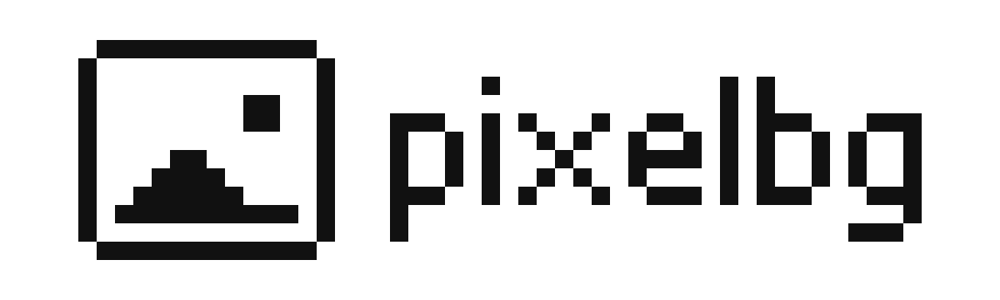
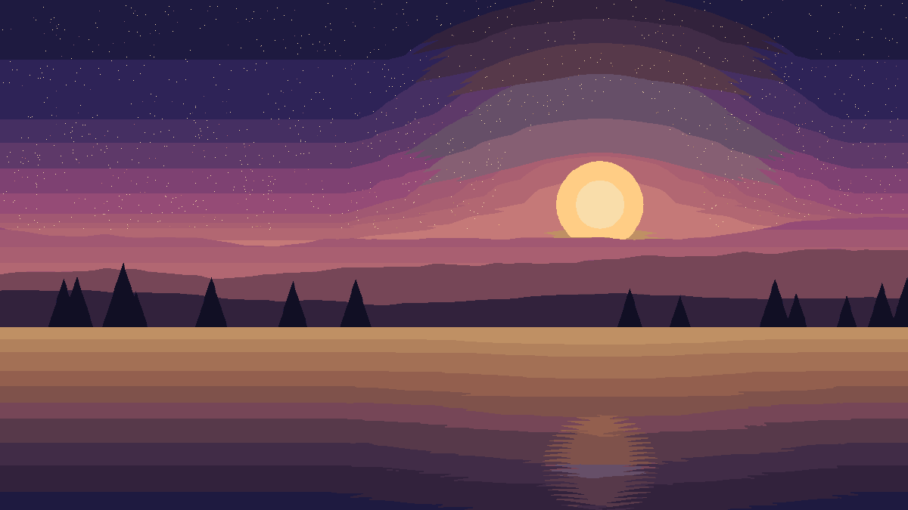
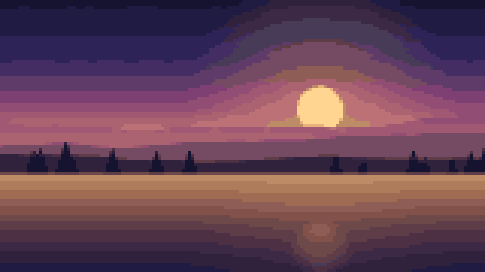
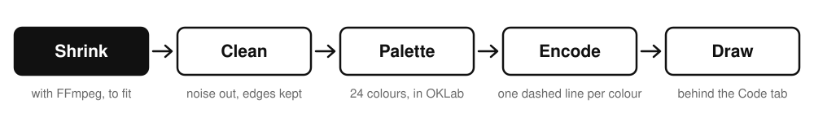

<p align="center">
  <picture>
    <source media="(prefers-color-scheme: dark)" srcset="assets/brand/logo-dark-1200.png">
    
  </picture>
</p>

<p align="center">
  <a href="https://github.com/owoevan-dev/pixelbg/actions/workflows/ci.yml"></a>
  <a href="LICENSE"></a>
  
  
</p>

<p align="center"><strong>Your picture, in pixels, behind your code.</strong></p>

pixelbg is a mod for the Claude desktop app. It turns a picture of yours into pixel art and draws it
behind the Code tab, with the panels as frosted glass over it. If you like, the app's own colours
(sidebar, panels, buttons) follow the picture too.

It works offline, on your computer: pixelbg makes no network connections, and FFmpeg is allowed to
open local files only. You keep a small library of pictures in a side panel, and switch between them
with one click.

<p align="center">
  
</p>

> **0.1.0 is a test release:** still pictures only, on Claude Code's mod support, which is early
> access and may change. [Bug reports](https://github.com/owoevan-dev/pixelbg/issues) are welcome.

## Quick start

1. Install [FFmpeg](https://ffmpeg.org/download.html), which pixelbg uses to read pictures:

   ```
   winget install Gyan.FFmpeg        # Windows
   brew install ffmpeg               # macOS
   ```

   On Linux, your distribution's `ffmpeg` package.
2. Install pixelbg. In the Code tab:

   ```
   /plugin install pixelbg --marketplace owoevan-dev/pixelbg
   ```

3. Type `/pixelbg` to open the panel and paste a picture's path: it joins your library and becomes
   the backdrop. (Pictures from your recent files join the library with `+`; press Use on a card to
   show it.)

## Two kinds of pixel

| | High quality | Normal |
|---|---|---|
| Width | the widest that fits, up to 1,200 pixels | the width you pick: 48 to 1,200 in the panel, 16 to 1,200 with `/pixelbg size` |
| Looks like | the picture, in a few dozen colours | pixel art: big, square pixels |
| Example |  |  |

Both show the same [scene](docs/images/demo-source.png), drawn by
[scripts/make-art.mjs](scripts/make-art.mjs); the pixel versions are pixelbg's own output for it. You
choose the colours too, from 4 to 64 in the panel or 2 to 64 with `/pixelbg colors` (24 by default): fewer colours give a flatter, more graphic look,
and in high quality, more pixels.

## How it works

<p align="center">
  <picture>
    <source media="(prefers-color-scheme: dark)" srcset="docs/images/pipeline-dark.svg">
    
  </picture>
</p>

<details>
<summary><b>The five steps in detail</b></summary>

The desktop app draws a mod's backdrop from SVG documents, at most 131,072 characters each and about
262,144 in all, and allows no bitmaps inside them. Everything below serves fitting a picture into
that space.

1. **Shrink.** FFmpeg reads the picture (PNG, JPEG, WebP, GIF, BMP, TIFF or AVIF) and scales it:
   area averaging when shrinking, square pixels when enlarging a small sprite.
2. **Clean.** Each pixel is averaged with those neighbours whose colour is close to its own, so flat
   areas lose their noise and edges stay sharp. Fewer colour changes along a row mean fewer runs to
   draw.
3. **Palette.** Median cut seeds the palette; k-means in the OKLab colour space, where distances
   follow what the eye sees, refines it. Lone specks then take their neighbours' colour.
4. **Encode.** Colours are painted most frequent first, the first as one rectangle. Each other colour
   is a single dashed stroke along a zigzag through every row, its dashes being that colour's runs, so
   a run costs two numbers. That is about 31% smaller than the plain encoding (one path per colour,
   moving along each row). High quality searches for
   the widest picture that fits in two documents.
5. **Draw.** The documents become the backdrop, with a separate layer for dimming, so the dimming
   slider changes nothing in the pixels. With the switch on, the app's theme is built from the
   palette.

The tests paint every document back into pixels and require an exact match. The measurements behind
these choices are in [docs/design.md](docs/design.md).

</details>

## More

<details>
<summary><b>Commands</b></summary>

The panel holds everything; the same controls are commands too.

| Command | What it does |
|---|---|
| `/pixelbg` | Open the panel |
| `/pixelbg set <path, file name or number>` | Use a picture |
| `/pixelbg recent` | List the newest pictures in Downloads, Pictures and Desktop |
| `/pixelbg quality <normal\|hd>` | Pick the width yourself, or find the largest that fits |
| `/pixelbg size <16-1200>` | Use this width (switches to normal) |
| `/pixelbg colors <2-64>` | Number of colours (default 24) |
| `/pixelbg fit <cover\|contain>` | Fill the window and crop, or show the whole picture |
| `/pixelbg dim <0-90>` | Darken the backdrop by this many percent (default 15) |
| `/pixelbg glass <blur 0-64> <opacity 0-100>` | The panels' frosted glass (default 0 55) |
| `/pixelbg tint <on\|off>` | App colours from the picture, or the app's own |
| `/pixelbg on` · `/pixelbg off` | Turn the backdrop on or off |
| `/pixelbg ffmpeg <path>` | Where FFmpeg is, when it is not on the PATH |
| `/pixelbg language <auto\|code>` | The language pixelbg speaks (see [Questions](#more)) |
| `/pixelbg help` | The current state and this list |

</details>

<details>
<summary><b>Install</b></summary>

**In the Code tab**

```
/plugin install pixelbg --marketplace owoevan-dev/pixelbg
```

**From a terminal**

```bash
claude plugin install pixelbg --marketplace owoevan-dev/pixelbg
```

It needs the Claude desktop app with Claude Code 2.1.325 or newer, and FFmpeg (see
[Quick start](#quick-start)). The backdrop shows only in the desktop app's Code tab; in a terminal the
commands work, but there is nothing to draw on.

**Removing it.** Uninstall the plugin, then delete the `pixelbg` folder in `%LOCALAPPDATA%` (Windows)
or `~/.pixelbg`, which holds the settings, the backdrop and the library, the `pixelbg` folder in
your temporary folder, and `pixelbg-temp` in your local app data or home folder if it is there.
(Test builds before 0.1.0 used other files there; 0.1.0 leaves them alone, and you can delete them.)

</details>

<details>
<summary><b>What it reads, writes and runs</b></summary>

It reads the pictures you choose and, when you ask for recent files, the names of picture files in
Downloads, Pictures and Desktop. It writes its settings with the converted backdrop (one file), its
library (one small file per entry: a name, the picture's path, when it was added) and a thumbnail per
entry to `%LOCALAPPDATA%\pixelbg` or `~/.pixelbg`, and one temporary file per session, which it tries
to empty after every conversion, even a failed one, and tells you where it is if it cannot. It runs
FFmpeg on your pictures, which may open local files only, and, to find your language, at most one
registry read on Windows or one preference read on macOS each time it loads. Its command answers,
which Claude reads, name files only: an error from the system by its code, the full message being in
the panel. It refuses network shares, and sends nothing anywhere: no network connections, no
telemetry, no account ([PRIVACY.md](PRIVACY.md)).

</details>

<details>
<summary><b>Questions</b></summary>

**Why vectors, not the picture itself?** Claude Code defines an image backdrop, but the desktop app
does not draw it yet, and an SVG may not embed a bitmap. Pixels drawn as shapes are what fits.

**Why does a detailed picture come out narrower?** Every change of colour along a row costs
characters, and the backdrop has a fixed budget. Fewer colours give high quality more pixels.

**Does it slow the app down?** The conversion takes a few seconds once, when you choose a picture;
the result is kept, so a new session shows the backdrop at once. Drawing it is the desktop app's
ordinary work.

**Does every session show it?** Yes. A change made in one session (a new picture, off, the glass)
reaches every other open session within a few seconds, and every session ends up showing the same
thing. When two sessions change something while one is still converting, the later choice of each
setting wins; when both choose a picture, the one saved first stays, and the other says so. Two
changes saved in the very same instant are the exception: the last one saved stands, and the other
window's change to a different setting can be lost (make it again). A library change made in one
window shows in another window's panel the next time it is opened. Sessions that were already open
when you installed pixelbg get it after the app restarts.

**Can I use a GIF or a video?** A GIF shows its first frame. Moving pictures are not part of 0.1.0.

**Which languages does it speak?** Sixteen, following your system's language: English, 繁體中文
(`zh-TW`), 简体中文 (`zh-CN`), 日本語 (`ja`), 한국어 (`ko`), Español (`es`), Français (`fr`),
Deutsch (`de`), Português (Brasil) (`pt-BR`), Italiano (`it`), Bahasa Indonesia (`id`), हिन्दी
(`hi`), Русский (`ru`), Tiếng Việt (`vi`), ไทย (`th`) and Türkçe (`tr`). Any other system language
gets English. To choose one yourself, use the panel or `/pixelbg language <code>`. Mods cannot see
the desktop app's own language setting, so pixelbg follows the system's, which is usually the same.

**Do phone photos come out the right way up?** Yes: a photo marked as turned (as phones mark
portrait shots) is read upright, at its shown width and height.

</details>

<details>
<summary><b>Limits</b></summary>

- Still pictures only.
- A picture with very fine detail comes out narrower in high quality, to fit the desktop's limit.
- The backdrop shows only in the Claude desktop app.
- It appears once a conversation is open: the app's start screen runs no session, so no mod can
  draw there.
- In split view the desktop draws one backdrop across the whole window, not one per conversation.
- It is tested on Windows; macOS and Linux should work but have not been tried.
- Claude Code's mod support is early access, and a later version may change what pixelbg relies on.

</details>

## Documentation

| | |
|---|---|
| [docs/design.md](docs/design.md) | How a picture is drawn, and the measurements behind each choice |
| [PRIVACY.md](PRIVACY.md) | Every file it reads and writes, and every program it runs |
| [SECURITY.md](SECURITY.md) | Reporting a vulnerability, and what matters for security |
| [THIRD_PARTY.md](THIRD_PARTY.md) | What it uses from others |
| [CHANGELOG.md](CHANGELOG.md) | What changed in each version |
| [CONTRIBUTING.md](CONTRIBUTING.md) | Reporting a problem; the layout, the tests and the release checks |

## Contributing

Bug reports, ideas and corrections to a language are welcome as
[issues](https://github.com/owoevan-dev/pixelbg/issues). pixelbg does not take pull requests for now;
you are welcome to fork it under the MIT licence. [CONTRIBUTING.md](CONTRIBUTING.md) has the layout and
the checks, for working on a copy of your own.

## Licence

[MIT](LICENSE) © 2026 owoevan-dev, except `hooks/make-colors.js` and its declarations, which are
Anthropic's, copied unchanged from Claude Code's plugin-authoring skill ([THIRD_PARTY.md](THIRD_PARTY.md)).
Every picture in this repository is drawn by its scripts from code alone.
